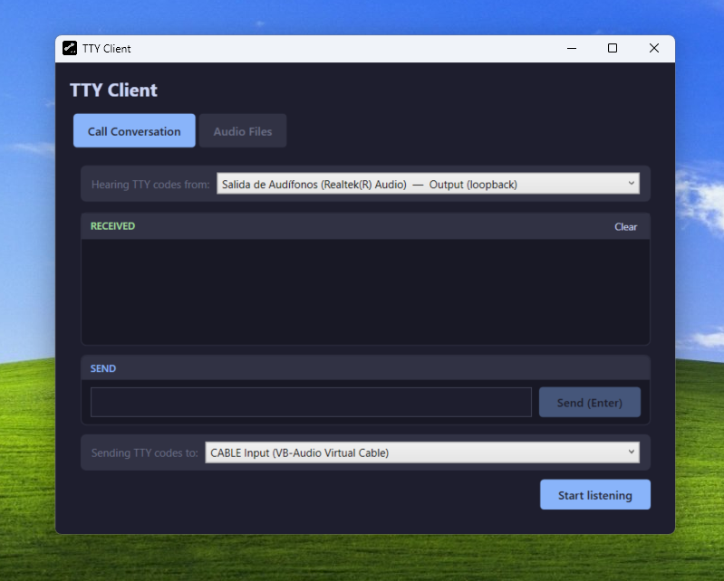
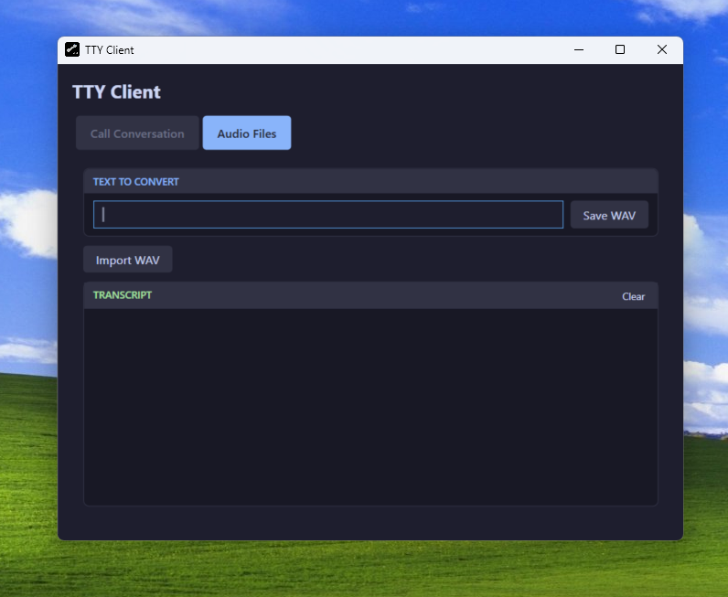
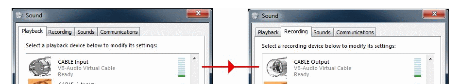
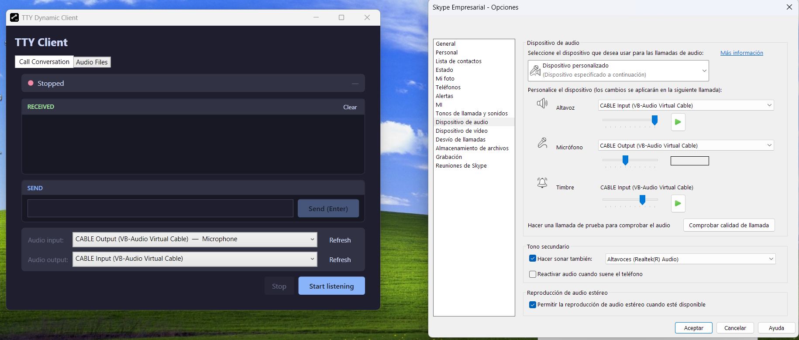

# TTY Client

[](https://github.com/mvergaram/tty-client/actions/workflows/release.yml)

TTY/TDD software client for Windows 11 that captures softphone call audio and decodes/encodes Baudot FSK tones in real time.





## TTY Protocol

This app implements the [**US Weitbrecht TTY/TDD standard**](https://en.wikipedia.org/wiki/Telecommunications_device_for_the_deaf#Original_5-bit_Baudot_code), the protocol used by TTY devices over the telephone network in the United States:

- **Modulation**: audio-frequency FSK (Frequency-Shift Keying)
- **MARK frequency**: 1400 Hz (binary 1 / idle tone)
- **SPACE frequency**: 1800 Hz (binary 0)
- **Baud rate**: 45.45 baud (~22 ms per bit)
- **Character encoding**: Baudot code, ITA-2 variant — 5 data bits per character, with LTRS/FIGS shift codes to switch between letters and digits/punctuation
- **Frame structure**: 1 START bit (SPACE) + 5 DATA bits (LSB first) + 1.5 STOP bits (MARK)
- **Sample rate**: 8000 Hz internally, matching standard telephony audio

Decoding measures tone power at 1400 Hz and 1800 Hz with the [Goertzel algorithm](https://en.wikipedia.org/wiki/Goertzel_algorithm) over short, overlapping windows, then reconstructs each character by locking onto its own start-bit edge instead of free-running a block counter — this keeps bit sampling correctly aligned even though the gap between characters (stop bits, a human typist's pauses) isn't a fixed length.

#### Noise

Noise on the line is handled in three ways. First, each bit decision is a *relative* comparison — whichever of the two tones (1400 Hz vs. 1800 Hz) carries more power wins — rather than a fixed energy threshold that line noise could trip or mask. Second, the 80-sample (10 ms) analysis window was tuned empirically against a real TTY recording with added white noise: it decodes about 3 dB further into the noise floor than a shorter window, while still tolerating the clock drift a real gateway introduces (longer windows reject noise even better but start missing bits once transmitter/receiver clocks drift more than a few percent). Third, the bit synchronizer treats a start-bit edge as a candidate, not a certainty — if a noise spike doesn't hold steady through the start bit's own center, it's dismissed as a false trigger and the receiver goes back to idle instead of decoding a spurious character.

TTY tones only survive a call path that doesn't transcode or compress the audio, which is why this only works over a real PSTN (Public Switched Telephone Network) call with [G.711](https://en.wikipedia.org/wiki/G.711) (see [Installation and setup](#installation-and-setup) below) — calls that stay within the same softphone platform often use a proprietary codec and strip the tones out.

See [`CLAUDE.md`](CLAUDE.md) for the fixed-parameters table and the full decode/encode pipeline diagrams.

## Requirements

- Windows 11
- .NET 10 Desktop Runtime (or build/publish self-contained, see below)
- **[VB-CABLE Virtual Audio Device](https://vb-audio.com/Cable/)** — free virtual audio driver, **required** to send the synthesized TTY tones to your softphone

### Why is VB-CABLE needed?

Most softphones don't allow injecting arbitrary audio directly: they only transmit whatever they receive from the device configured as the **microphone**. VB-CABLE solves this by creating a pair of virtual audio devices in Windows:

> Simple & Easy! All audio streams sent to VB-CABLE inputs (Playback Device) will be forwarded to VB-CABLE outputs (Recording Device).

In other words: everything this app plays to **"CABLE Input"** (which Windows sees as a playback device) automatically shows up on **"CABLE Output"** (which Windows sees as a recording device). This lets "CABLE Output" be used as if it were a real microphone.

Concrete flow in this app:

1. The user types a message and the app encodes it as FSK tones (Baudot ITA-2).
2. The app plays those tones to **CABLE Input** (the "Sending TTY codes to" device in the UI).
3. VB-CABLE forwards that signal to **CABLE Output**.
4. In your softphone, configured with **CABLE Output** as its microphone, the tones are transmitted as if they were the user's voice.

## Installation and setup

1. Download and install VB-CABLE from <https://vb-audio.com/Cable/>.
2. In your softphone's audio settings → **Microphone**: select `CABLE Output (VB-Audio Virtual Cable)`.
3. In the app, in the **"Sending TTY codes to"** selector, choose `CABLE Input (VB-Audio Virtual Cable)`.
4. The call must connect to a **real PSTN number** with the gateway/SIP trunk set to **G.711 without transcoding** — calls that stay within the same softphone platform often use a proprietary codec and don't preserve the FSK tones.

> VB-CABLE is a kernel driver; it may require IT approval in corporate environments.

Once installed, VB-CABLE adds the **CABLE Input** (playback) and **CABLE Output** (recording) devices to Windows' Sound settings:



Side-by-side device configuration — TTY Client's "Hearing TTY codes from"/"Sending TTY codes to" selectors on the left, the softphone's microphone/speaker settings on the right:



## Build and run

```bash
# `dotnet run` builds automatically, so a separate `dotnet build` isn't needed
dotnet run
```

Run the test suite (`TtyClient.Tests`, xUnit) with:

```bash
dotnet test TtyClient.Tests/TtyClient.Tests.csproj
```

The release workflow (below) runs this same command before publishing, so a failing test blocks the release.

## Publish a standalone executable

```bash
dotnet publish TtyClient.csproj -c Release -r win-x64 --self-contained true -p:PublishSingleFile=true -p:IncludeNativeLibrariesForSelfExtract=true
```

The resulting `.exe` ends up at `bin\Release\net10.0-windows\win-x64\publish\TtyClient.exe`.

## GitHub build and release

A GitHub Actions workflow (`.github/workflows/release.yml`) runs this exact command automatically on every push to `main` and publishes the resulting `.exe` as a GitHub Release (see the badge at the top of this file) — running it manually like above is only needed for local testing.

More details on architecture, the audio pipeline, and TTY parameters in [`CLAUDE.md`](CLAUDE.md).
