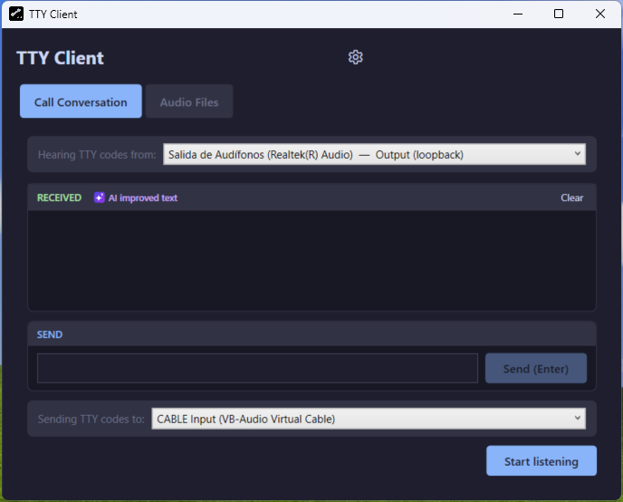
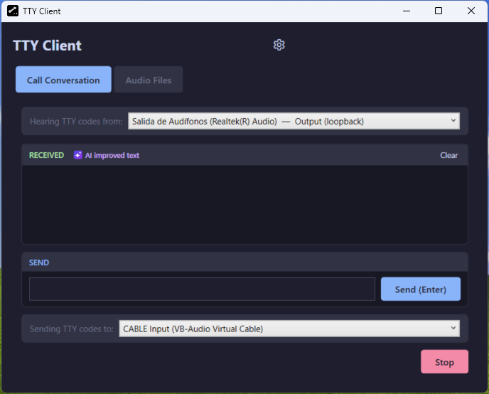
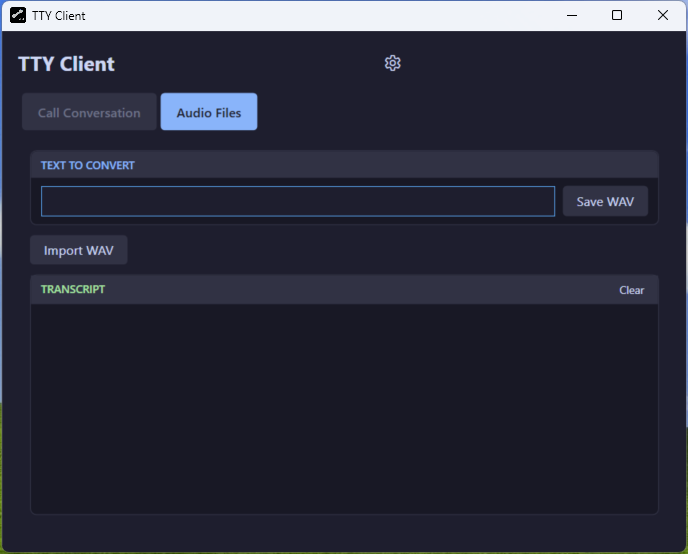
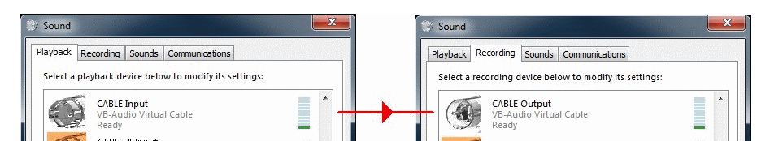
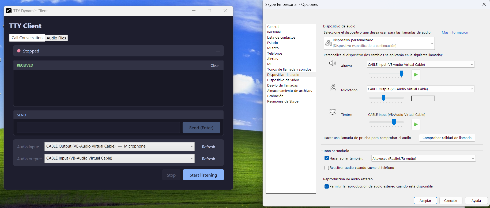
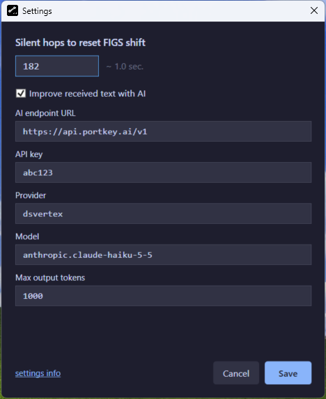

# TTY Client

[](https://github.com/mvergaram/tty-client/actions/workflows/release.yml)

TTY/TDD software client for Windows 11 that captures softphone call audio and decodes/encodes Baudot FSK tones in real time.







## TTY Protocol

This app implements the [**US Weitbrecht TTY/TDD standard**](https://en.wikipedia.org/wiki/Telecommunications_device_for_the_deaf#Original_5-bit_Baudot_code), the protocol used by TTY devices over the telephone network in the United States:

- **Modulation**: audio-frequency FSK (Frequency-Shift Keying)
- **MARK frequency**: 1400 Hz (binary 1 / idle tone)
- **SPACE frequency**: 1800 Hz (binary 0)
- **Baud rate**: 45.45 baud (~22 ms per bit)
- **Character encoding**: Baudot code, ITA-2 variant — 5 data bits per character, with LTRS/FIGS shift codes to switch between letters and digits/punctuation
- **Frame structure**: 1 START bit (SPACE) + 5 DATA bits (LSB first) + 1.5 STOP bits (MARK)
- **Sample rate**: 8000 Hz internally, matching standard telephony audio

Decoding measures tone power at 1400 Hz and 1800 Hz with the [Goertzel algorithm](https://en.wikipedia.org/wiki/Goertzel_algorithm) over short, overlapping windows, then reconstructs each character by locking onto its own start-bit edge instead of free-running a block counter — this keeps bit sampling correctly aligned even though the gap between characters (stop bits, a human typist's pauses) isn't a fixed length.

### Noise

Noise on the line is handled in three ways:
* First, each bit decision is a *relative* comparison — whichever of the two tones (1400 Hz vs. 1800 Hz) carries more power wins — rather than a fixed energy threshold that line noise could trip or mask.
* Second, the 80-sample (10 ms) analysis window was tuned empirically against a real TTY recording with added white noise: it decodes about 3 dB further into the noise floor than a shorter window, while still tolerating the clock drift a real gateway introduces (longer windows reject noise even better but start missing bits once transmitter/receiver clocks drift more than a few percent).
* Third, the bit synchronizer treats a start-bit edge as a candidate, not a certainty — if a noise spike doesn't hold steady through the start bit's own center, it's dismissed as a false trigger and the receiver goes back to idle instead of decoding a spurious character.

TTY tones only survive a call path that doesn't transcode or compress the audio, which is why this only works over a real [PSTN (Public Switched Telephone Network)](https://en.wikipedia.org/wiki/Public_switched_telephone_network) call with [G.711](https://en.wikipedia.org/wiki/G.711) (see [Installation and setup](#installation-and-setup) below) — calls that stay within the same softphone platform often use a proprietary codec and strip the tones out.

See [`AGENTS.md`](AGENTS.md) for the fixed-parameters table and the full decode/encode pipeline diagrams.

## Requirements

- Windows 11
- .NET 10 Desktop Runtime (or build/publish self-contained, see below)
- **[VB-CABLE Virtual Audio Device](https://vb-audio.com/Cable/)** — free virtual audio driver, **required** to send the synthesized TTY tones to your softphone

### Why is VB-CABLE needed?

Most softphones don't allow injecting arbitrary audio directly: they only transmit whatever they receive from the device configured as the **microphone**. VB-CABLE solves this by creating a pair of virtual audio devices in Windows:


> Simple & Easy! All audio streams sent to VB-CABLE inputs (Playback Device) will be forwarded to VB-CABLE outputs (Recording Device).

## Installation and setup

1. Download and install VB-CABLE from <https://vb-audio.com/Cable/>.
2. In your softphone's audio settings → **Microphone**: select `CABLE Output (VB-Audio Virtual Cable)`.
3. In the app, in the **"Sending TTY codes to"** selector, choose `CABLE Input (VB-Audio Virtual Cable)`.
4. The call must connect to a **real PSTN number** with the gateway/SIP trunk set to **G.711 without transcoding** — calls that stay within the same softphone platform often use a proprietary codec and don't preserve the FSK tones.

> VB-CABLE is a kernel driver; it may require IT approval in corporate environments.

Once installed, VB-CABLE adds the **CABLE Input** (playback) and **CABLE Output** (recording) devices to Windows' Sound settings.


> Side-by-side device configuration — TTY Client's "Hearing TTY codes from"/"Sending TTY codes to" selectors on the left, the softphone's microphone/speaker settings on the right:

## Test, Build and Run

Run the test suite with:
```bash
dotnet test TtyClient.Tests/TtyClient.Tests.csproj
```
The release workflow (below) runs this same command before publishing, so a failing test blocks the release.

Run the app with:
```bash
# `dotnet run` builds automatically, so a separate `dotnet build` isn't needed
dotnet run
```

## Publish a standalone executable

```bash
dotnet publish TtyClient.csproj -c Release -r win-x64 --self-contained true -p:PublishSingleFile=true -p:IncludeNativeLibrariesForSelfExtract=true
```
The resulting `.exe` ends up at `bin\Release\net10.0-windows\win-x64\publish\TtyClient.exe`.

## Settings



Open it with the gear button next to the "TTY Client" title, in the top right of the main window.
All settings are saved as JSON in `%AppData%\TtyClient\settings.json`.

### Silent hops to reset FIGS shift

**Default: 182 hops (~1 second)**

How many consecutive silent moments (no TTY tone detected) must pass before the receiver resets
back to the LTRS (letters) shift state, so the next message starts clean even if the remote end
never resent a shift code. Only a positive integer is accepted; the dialog shows the equivalent
time in seconds live. It only takes effect the next time you
press "Start listening" or import a WAV file — it doesn't change a capture that's already running.

### Improve received text with AI

Checkbox that, once enabled, runs every received message through an LLM (via
[Portkey](https://portkey.ai/docs/introduction/what-is-portkey)) to clean up typos caused by audio
noise or FIGS/LTRS shift mix-ups. Default: **disabled**. Checking it reveals five more fields,
grayed out until then:

| Field | Default | Where to get it for your own setup |
|---|---|---|
| **AI endpoint URL** | `https://api.portkey.ai/v1` | Portkey Cloud's gateway URL; change it only if you run a [self-hosted Portkey gateway](https://portkey.ai/docs/product/open-source). |
| **API key** | *(empty)* | Create one from your account's [Portkey API Keys](https://portkey.ai/docs/api-reference/admin-api/introduction#creating-and-managing-api-keys) page. |
| **Provider** | `dsvertex` | The slug of an AI provider integration (OpenAI, Azure OpenAI, Vertex AI, Bedrock, etc.) configured in your Portkey [Model Catalog](https://portkey.ai/docs/product/model-catalog) — ask whoever administers your organization's Portkey account for the slug to use. |
| **Model** | `anthropic.claude-haiku-5-5` | The model ID exposed by that provider integration, listed in Portkey's [Model Catalog](https://portkey.ai/docs/product/model-catalog) or at [portkey.ai/models](https://portkey.ai/models). |
| **Max output tokens** | `1000` | Caps the length (and cost) of the AI's reply; raise it only if replies are getting cut off. |

A field left blank (or, for "Max output tokens", set to zero/negative) falls back to its own
default independently. Unlike the hops setting above, these AI fields apply immediately on Save,
even to a call already in progress.

## GitHub build and release

A GitHub Actions workflow (`.github/workflows/release.yml`) runs publish command automatically on every push to `main` and publishes the resulting `.exe` as a GitHub Release (see the badge at the top of this file) — running it manually like above is only needed for local testing.

More details on architecture, the audio pipeline, and TTY parameters in [`AGENTS.md`](AGENTS.md).
